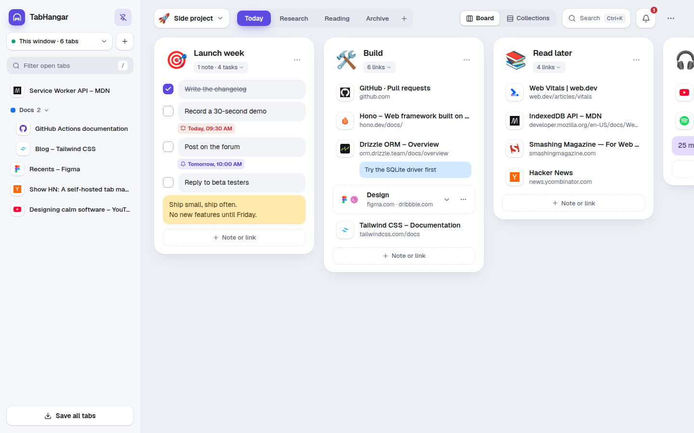
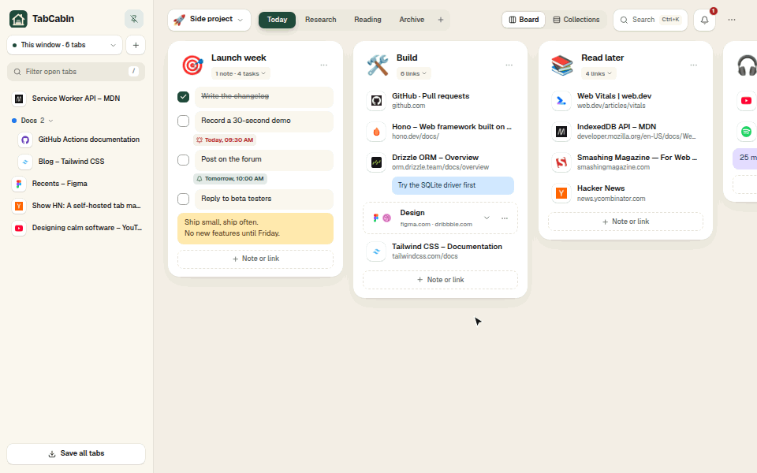
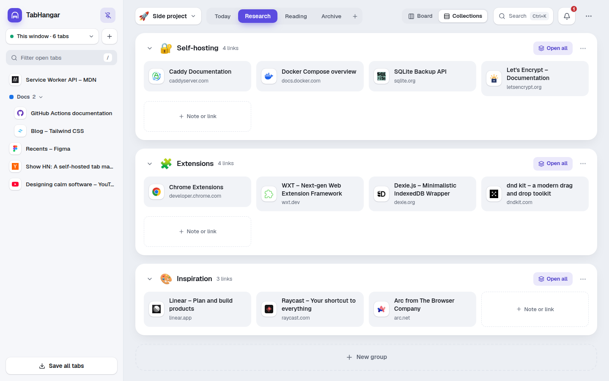
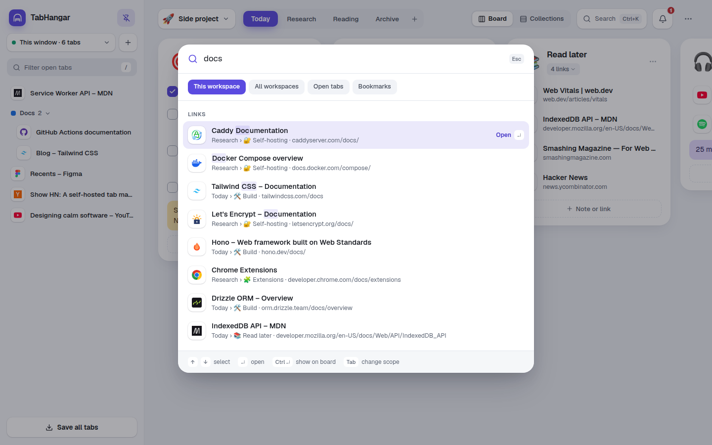
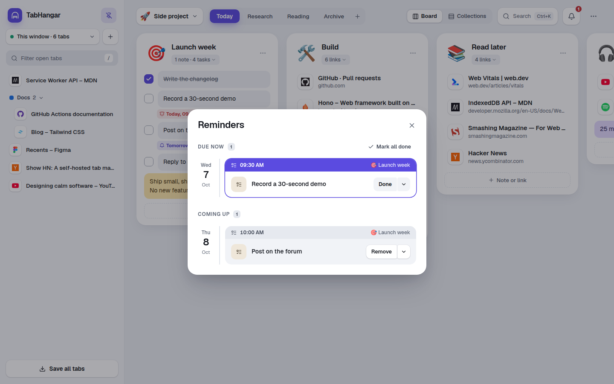
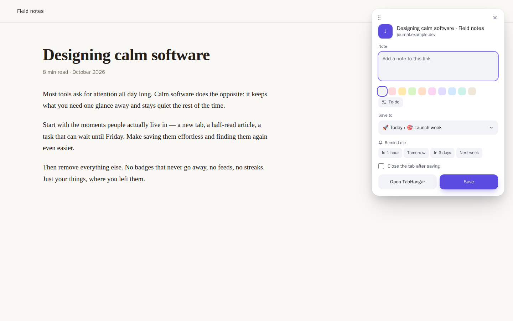

<div align="center">


# TabCabin

**A calm cabin for your tabs.** TabCabin is a **Chrome extension** that turns every new tab into
quiet boards for your tabs, links, notes and to-dos — on your computer, and in sync between your
computers when you sign in.




</div>

## Why

Tabs pile up because closing them feels like losing them. TabCabin gives every tab a place to
stay: drag it into a group, add a note, set a reminder, close it. Everything is one new tab away,
searchable, and works offline. No account needed and no tracking.



▶ [Watch the 50-second film](apps/landing/public/promo.mp4) (with music)

## Features

**Organize**

- **Board view** — categories as tabs, groups as columns with big emoji headers, resizable and collapsible
- **Collections view** — the same groups as wide panels of link cards, per category
- **Notes and to-dos** inside groups, nine colors, `- ` bullets, `/todo` and `/done` shortcuts, Enter + Enter for the next note
- **Stacks** — hold one link over another to combine them; open all at once
- **Workspaces** — separate boards for work, home and side projects, empty or from a template (Work, Home, Study, Side project); move groups and categories between them
- **Drag and drop everywhere** — items, groups, open tabs, whole Chrome tab groups; drop on a category tab to move there, on the trash to delete

**Capture**

- **Open tabs panel** — every window and native tab group; select several tabs and save them in one go, close duplicates, or save a whole window as one group and close it (open it again later in one click)
- **Right-click menu** — save the page, a link, a text selection (as a note) or an image to any group
- **Save popover** (`Ctrl+Shift+S`) — add a sticky note, pick the group, set a reminder, close the tab
- **Inbox** (`Alt+Shift+S`) — save the page without choosing a group; it waits first on every board until you drag it where it belongs
- The toolbar icon shows how many times the current page is already saved
- A short note when a link you save is already in another group, with a button to show it (can be turned off)

**Find and remember**

- **Search** (`⌘K` / `Ctrl+K`) across the workspace, all workspaces, open tabs and bookmarks; jump to any result on the board
- **Reminders** — one-time, weekly or monthly; desktop notifications, snooze, and a due count on the toolbar icon
- **Bin** — restore deleted groups and items, or delete them for good
- **Undo** for every change (`⌘Z` / `Ctrl+Z`)

**Make it yours**

- Light and dark themes, compact density, English and Polish
- Rebindable keyboard shortcuts and a cheat sheet on `?`
- **Import** TabCabin backups, **Toby** and **tabExtend** exports, bookmark files (Chrome, Firefox, Safari, Raindrop), OneTab lists, Chrome bookmark folders and your most visited sites
- **Export** a workspace or everything as JSON, a bookmarks file or CSV

<table>
  <tr>
    <td></td>
    <td></td>
  </tr>
  <tr>
    <td></td>
    <td></td>
  </tr>
</table>

## Sync between computers

Click **Sign in** in the top bar and continue with Google (or a username and password). From then on
syncing runs by itself: every change is sent right away and changes from your other computers arrive
live. Without an account everything stays in your browser.

**Your own server** — run the small sync server on your machine or a VPS (Docker, SQLite, automatic
HTTPS with Caddy, optional Google sign-in, limits for public servers) and build the extension with
its address. See [docs/self-hosting.md](docs/self-hosting.md).

```bash
cp .env.example .env    # domain, first account, sign-up rules
docker compose --profile caddy up -d
```

## Install

TabCabin is not in the Chrome Web Store yet.

**From a release** — download `tabcabin-<version>-chrome.zip` from
[Releases](https://github.com/DontAskForAnything/tabcabin/releases), unzip it, open
`chrome://extensions`, turn on **Developer mode** and choose **Load unpacked** → the unzipped folder.

**From source**

```bash
pnpm install
pnpm build:ext   # → apps/extension/.output/chrome-mv3
```

Then load `apps/extension/.output/chrome-mv3` with **Load unpacked**. Works in Chrome, Edge, Brave and
other Chromium browsers.

**With your own addresses** — the sync server and the website address are set when you build, never
in the code:

| Variable           | Used by                                | Example                               |
| ------------------ | -------------------------------------- | ------------------------------------- |
| `WXT_SYNC_SERVER`  | the extension (sync server)            | `https://tabs.example.com`            |
| `WXT_SITE_URL`     | the extension (website link, Settings) | `https://example.com`                 |
| `SITE_URL`         | the website (links, sitemap)           | `https://example.com`                 |
| `EXTENSION_URL`    | the website (download buttons)         | the Chrome Web Store page             |
| `REPO_URL`         | the website (GitHub links)             | the GitHub repository                 |
| `UMAMI_SCRIPT_URL` | the website (visit counts, optional)   | `https://stats.example.com/script.js` |
| `UMAMI_WEBSITE_ID` | the website (visit counts, optional)   | the id from the Umami dashboard       |

Put them in `apps/extension/.env` / your shell, or set them once as repository variables on GitHub
(**Settings → Secrets and variables → Actions → Variables**) and run the manual **Build** workflow,
which uploads the extension zip and the website as downloads (it fills `WXT_SITE_URL` from
`SITE_URL`). Without `WXT_SYNC_SERVER` the extension is built without sync and works offline only.
Without `EXTENSION_URL` the website says "Coming soon" instead of "Get it for Chrome", and without
`REPO_URL` it has no GitHub links.

## Privacy

Your data lives in the browser's IndexedDB. It only leaves the browser when you sign in, and then
only to the sync server the extension was built with. TabCabin has no analytics and no tracking; apart
from sync, the only things it loads from the web are the icons and images of pages you saved.
Permissions it asks for:

| Permission                                            | Why                                                                                           |
| ----------------------------------------------------- | --------------------------------------------------------------------------------------------- |
| `tabs`, `tabGroups`                                   | Show and save your open tabs and native tab groups                                            |
| `contextMenus`, `activeTab`, `scripting`              | Right-click saving and the save popover on the page you are looking at (only after you click) |
| `storage`, `unlimitedStorage`                         | Keep your boards locally                                                                      |
| `favicon`                                             | Show site icons from the browser's own cache                                                  |
| `alarms`                                              | Fire reminders on time                                                                        |
| `sidePanel`                                           | Open the board in the side panel                                                              |
| `bookmarks`, `topSites`, `notifications` _(optional)_ | Asked only when you use bookmark search/import, most visited sites or desktop notifications   |
| `identity` _(optional)_                               | Asked only when you choose **Continue with Google**, to open Google's sign-in window          |

The extension has **no host permissions**: it cannot read pages unless you invoke it on one.

## Keyboard shortcuts

| Action                             | Shortcut                       |
| ---------------------------------- | ------------------------------ |
| Search                             | `⌘K` / `Ctrl+K`                |
| Switch workspace                   | `⌘O` / `Ctrl+O`                |
| New group                          | `G`                            |
| Switch category                    | `1`–`9`                        |
| Undo                               | `⌘Z` / `Ctrl+Z`                |
| Open the bin                       | `⌘⇧⌫` / `Ctrl+Shift+Backspace` |
| Save the current page (popover)    | `⌘⇧S` / `Ctrl+Shift+S`         |
| Save the current page to the Inbox | `⌃⇧S` / `Alt+Shift+S`          |
| All shortcuts                      | `?`                            |

Most of them can be changed in **Settings → Shortcuts**.

## Development

Requirements: Node.js 22+ and pnpm.

```bash
pnpm install
pnpm dev:ext        # extension with hot reload (opens a browser)
pnpm test           # unit tests (Vitest)
pnpm e2e            # end-to-end tests: builds the extension and runs Playwright in Chromium
pnpm typecheck && pnpm lint && pnpm format:check
pnpm zip:ext        # store-ready zip in apps/extension/.output
```

The screenshots in this README are generated from demo data with
`pnpm --filter @tabcabin/extension screenshots`. Logos, colours, type and voice are described in the
[brand guide](docs/brand.md).

The promo film (`apps/landing/public/promo.mp4`) and its stills in [`docs/promo/`](docs/promo) are
rendered with `pnpm --filter @tabcabin/extension promo` (needs ffmpeg). Every frame is drawn from a
real recording of the extension, and the soundtrack is synthesized from scratch by
`scripts/promo/music.ts`, so there is no third-party audio or footage to license.

### Repository layout

```
apps/extension      Chrome extension (WXT, React): new tab, side panel, background, content scripts
apps/server         self-hosted sync server (Hono, SQLite, Drizzle) and its Docker image
packages/core       data model, ordering, reminders, import/export — no browser APIs, fully unit tested
packages/ui         design system: tokens, Tailwind theme, accessible components on Radix
apps/landing        website (Astro): home, self-hosting, comparisons, privacy, the film
docs/               architecture, data model, brand guide and logos, screenshots, promo stills
```

Read more in [docs/architecture.md](docs/architecture.md) and [docs/data-model.md](docs/data-model.md).

### Tech stack

TypeScript · React 19 · Tailwind CSS 4 · Radix UI · Motion · dnd-kit · Dexie (IndexedDB) · Zod ·
WXT (Manifest V3) · Hono · SQLite (better-sqlite3) · Drizzle ORM · Docker · Caddy · Vitest · Playwright ·
axe-core

## Roadmap

- [x] Local-first Chrome extension (board, collections, panel, saving, search, reminders, bin, import/export)
- [x] Self-hosted sync server — Docker image, Google or password sign-in, live sync between browsers
- [x] Website with comparison pages, a privacy page and the film
- [ ] Chrome Web Store listing

See [CHANGELOG.md](CHANGELOG.md) for what changed in each version.

## License

[MIT](LICENSE)
