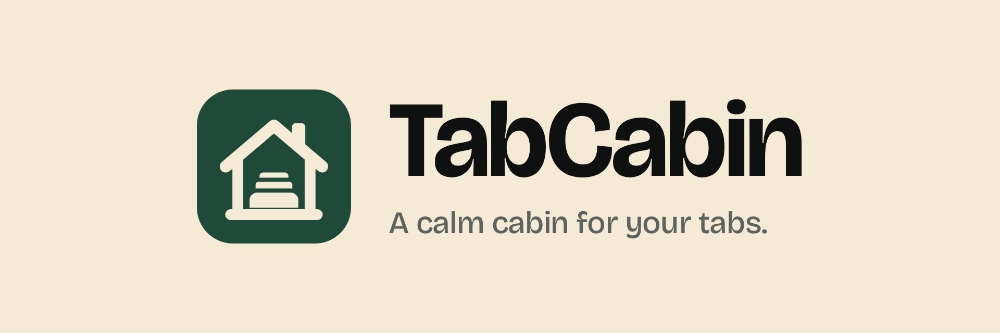

# TabCabin brand guide

TabCabin is a calm cabin for your tabs. The look is quiet and grown-up: black, white and pine
green, with one soft cream for the logo. Nothing shouts.

## Logo

The mark is a small cabin with a chimney. Inside sit three tabs, each one further back narrower
and lower than the one in front, like tabs stacked in a browser. The house is always drawn in a
single colour; the thin gaps between the tabs take the colour of the tile.

| File                                     | Tile            | House           | Use it for                                          |
| ---------------------------------------- | --------------- | --------------- | --------------------------------------------------- |
| [`logo.svg`](brand/logo.svg)             | pine `#1F4A3A`  | cream `#F4EAD5` | The main logo: browser toolbar, store, app, website |
| [`logo-cream.svg`](brand/logo-cream.svg) | cream `#F4EAD5` | pine `#1F4A3A`  | On pine, on photos, on dark pages                   |
| [`logo-black.svg`](brand/logo-black.svg) | black `#0F1110` | cream `#F4EAD5` | Monochrome, dark mode, merch                        |
| [`logo-print.svg`](brand/logo-print.svg) | white           | black `#0F1110` | Print: docs, stickers, one-colour jobs              |

Lockups with the wordmark and the tagline (PNG, 1920×640):
[cream](brand/lockup-light.png) · [dark](brand/lockup-dark.png) · [pine](brand/lockup-pine.png). Brand
moments such as lockups, the store tiles and the film use the full cream `#F4EAD5` as background;
the app itself sits on the lighter page colour.
They are rendered by `pnpm --filter @tabcabin/extension brand` from the SVGs above.

- **Clear space:** keep at least a quarter of the tile's width free on every side.
- **Smallest size:** 16 px in the browser, 24 px next to the wordmark. The extension icons at
  16/32/48/128 px are rendered from the same drawing (`apps/extension/assets/logo.svg`).
- **Wordmark:** "TabCabin" in Bricolage Grotesque 700 with slightly tight letter spacing
  (−0.02 to −0.025 em), one word, capital T and C. The mark sits to the left, about 1.4× the
  cap height, vertically centred.
- **Don't:** add a window, recolour the house in two colours, use gradients, outlines or
  shadows on the mark, rotate or stretch it, or place the pine tile on a busy photo.

## Colour

Strictly black, white and pine, plus one cream. Pine is the only accent: buttons, links, the
active tab, selection, drop targets and count badges. Everything else is ink on white or cream.
Contrast ratios are WCAG 2.1 against the page colour unless noted.

### Light

| Token         | Hex       | Contrast         | Used for                                                 |
| ------------- | --------- | ---------------- | -------------------------------------------------------- |
| Pine (accent) | `#1F4A3A` | 9.3:1            | Primary buttons, links, active tab, drop targets, badges |
| Pine hover    | `#173A2E` | 11.6:1           | Hover and pressed states                                 |
| Pine soft     | `#E3ECE7` | pine on it 8.3:1 | Selected rows, drop target fill                          |
| On pine       | `#FAF6EE` | 9.3:1 on pine    | Text and icons on pine                                   |
| Cream         | `#F4EAD5` | 8.4:1 on pine    | Logo house, brand moments                                |
| Ink           | `#0F1110` | 17.6:1           | Text and icons                                           |
| Muted         | `#5D635F` | 5.7:1            | Secondary text, hosts, hints                             |
| Page          | `#FAF6EE` |                  | App background                                           |
| Surface       | `#FFFFFF` |                  | Cards, menus, dialogs                                    |
| Sunken        | `#F2EEE5` |                  | Inputs, tracks, hover                                    |
| Line          | `#E7E2D8` |                  | Borders and dividers                                     |
| Danger        | `#B3261E` | 6.1:1            | Errors and the final destructive confirm only            |

### Dark

| Token               | Hex       | Contrast | Used for                                      |
| ------------------- | --------- | -------- | --------------------------------------------- |
| Page                | `#0F1110` |          | Background                                    |
| Surface             | `#181B19` |          | Cards, menus                                  |
| Raised              | `#202421` |          | Inputs, hover                                 |
| Line                | `#2B302C` |          | Borders                                       |
| Text                | `#F2F4F2` | 17.1:1   | Text and icons                                |
| Muted               | `#9AA29C` | 7.2:1    | Secondary text                                |
| Pine light (accent) | `#6DB592` | 7.8:1    | Accent; text on it is `#0F1110` (7.8:1)       |
| Pine soft           | `#1C2E25` |          | Selection, drop target fill                   |
| Danger              | `#F2867A` | 7.6:1    | Errors and the final destructive confirm only |

Everyday delete buttons are ink with a trash icon, not red. Red appears only for errors and for
the last, irreversible step (empty the bin, delete all data).

**Note colours** (rose, amber, lime, peach, pink, lilac, sky, teal, sand) are chosen by people for
their own notes. They stay colourful because they are content, not chrome, and are never used for
buttons or other UI.

In the browser toolbar the pine tile is quiet on dark themes; the cream house is what reads
there, so never darken the house.

## Type

- **Bricolage Grotesque 700**: the wordmark and big display headings on the website and in
  promo material.
- **Geist**: everything in the app (400 body, 500 labels, 600 headings).
- **Geist Mono**: keyboard shortcuts and code.

Radii are 6 (chips), 10 (rows, inputs, buttons), 14 (cards), 20 (panels) and pill. Shadows are
soft and low; a dragged card lifts with a pine border.

## Voice

Calm, warm and short. Say what happens in plain words people already use.

- **Tagline:** "A calm cabin for your tabs." In Polish: "Spokojny domek dla Twoich kart."
- **Headline on the website:** "A _calm_ cabin for your tabs", with "calm" in pine.
- **One-liner:** "TabCabin turns every new tab into quiet boards for your tabs, links, notes and
  to-dos — on your computer, synced when you sign in."
- **Store title:** "TabCabin – Tab Manager, Boards & Notes".
- **Short description (≤ 132 characters):** "A calm cabin for your tabs: boards for tabs, links,
  notes and to-dos in every new tab. Private, works offline."
- **Small lines that fit the voice:** "Close the tabs. Keep the thoughts." · "Every tab gets a
  place to stay." · "Your cabin, on every computer." · "Back to the cabin."

Do:

- Write short sentences with a calm tone.
- Use the cabin idea at most once per screen; most screens don't need it at all.
- Use pine for actions and ink for everything else.

Don't:

- Use exclamation marks or emoji in brand copy (people's own group emoji are fine).
- Mention servers, sync engines or other technical terms in the product.
- Put another accent colour next to pine.
